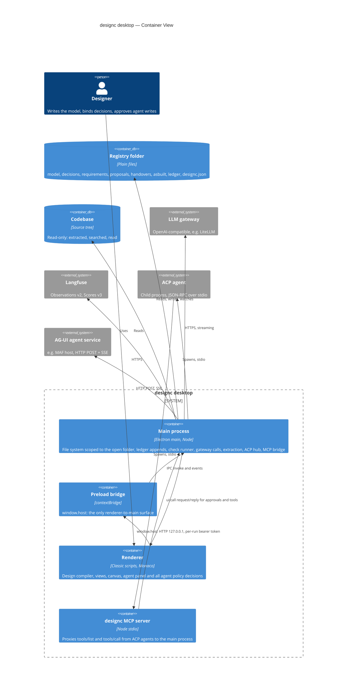
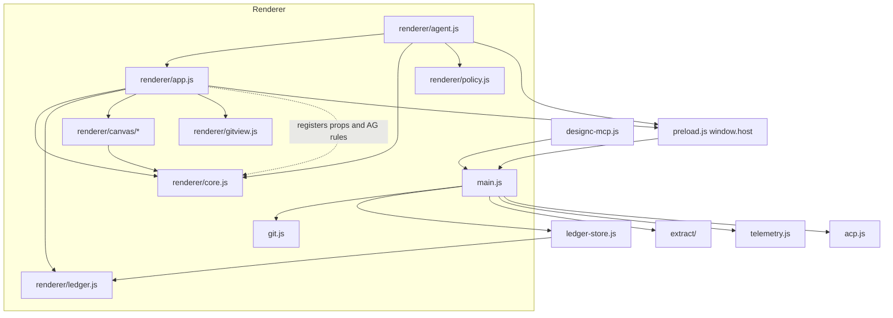

# Architecture — designc desktop

> Living document. Updated at the end of every /plan execution and
> whenever module boundaries or interfaces change.
> Source of truth for blast radius assessment, onboarding, and enterprise
> architecture aggregation.
> Last updated: 2026-10-02 — Improve view reads `agents.jsonl` (`Ledger.agentActivity`); deployment relationships and deployment view declarations parsed (`core.js`, mirrored in `python/designc/dsl.py`), shown in the Deployment tab. Earlier: Python CLI `python/designc` (`designc check`, parity-tested against `core.js`); doc claims about a pre-existing Python package corrected. Earlier: folder trust now works like VS Code (trusted ancestor covers subfolders; dialog offers folder, repository or parent). Earlier: re-bind of promotion-blocked decisions (`Core.rebindable`) and compare with last handover without git (`Core.latestHandoverModel`). Earlier: gap fixes (`paths.js`: symlink-aware `inside()`, secret-free child env, `designc.json` changes flagged during agent turns). Earlier: slice 12 (scenarios/*.yaml, `Core.scenarioReport`, `fitness` ledger kind, gate clauses, Scenarios section in the Design sidebar). Earlier: slice 11 (`Core.blastRadius` mode unavailable over deployment nodes, shown in the Deployment view). Earlier: slice 10 (deployment models: `model.deployment`, `Core.deploymentView`, read-only Deployment activity). Earlier: slice 9 (`Core.blastRadius` mode misbehaves, sheet badge option). Earlier: slice 8 (`Core.changeImpact`, shown in the Compare tab). Earlier: slice 7 (handover folders: `Core.handoverPlan`, freeze copies model, requirements, bound decisions, behaviour and vocabulary, pre-filled commit). Earlier: slice 6 (business decisions: `kind`, `relies_on`, `evidence` + `evidenceHosts`, requirement-version promotion, agent write limits). Earlier: slice 5 (`Core.fingerprint`, `promoted_against` written on bind, `decision_promoted` ledger kind, promotion gate clauses, agent write protection in `policy.js`). Earlier: slice 4 (`Core.diffModels` semantic diff; Compare tab shows a meaning-level summary for `.dsl` files). Earlier: slice 3 (slug ids, duplicate-id and unparseable-file gate clauses). Earlier: slice 2 (git daily loop): git writes in `git.js`, Source control view, `Ledger.order`/`escapeId`. Earlier: slice 1 (git read-only): new `git.js` (main) and `renderer/gitview.js`; `git:*` IPC; shared `ensureTrusted`. Earlier: slice 0 (agent write holes): new module `renderer/policy.js`; `acp.js` confines ACP writes to the registry; ledger changes during an agent turn are flagged.
> Earlier the same day: exploration finished. canvas, agent panel, ACP hub, MCP server,
> extract entry point and telemetry read and added. Verified by reading the code: `main.js`,
> `preload.js`, `ledger-store.js`, `renderer/ledger.js`, `renderer/core.js`, `acp.js`,
> `designc-mcp.js`, `extract/index.js`, the canvas `vocabulary`, `agentic-rules`, `dsl-edit`
> and `layout`, and the registry, decision, handover, grill-me, policy, tool and write paths
> of `renderer/app.js` and `renderer/agent.js`. Outlined only (function list, not bodies):
> the views, Monaco setup, C4 drawing and dashboards in `app.js`, the AG-UI loop in
> `agent.js`, `canvas.js`, `review.js`, `templates.js`, the scanners and linker under
> `extract/`, and `telemetry.js`; for those `AGENTS.md` is the reference.

## System Overview

designc is an Electron desktop IDE for system design in which the design is the source of
truth and code is a build output. One window hosts the design compiler (System 1), a view
of the coding pipeline's runs (System 2), the improvement loop (System 4), an as-built code
map extracted from a .NET and JS/TS codebase, and an agent panel. It opens a *registry*
folder of plain files (model, decisions, requirements, proposals, handovers, ledger). It
talks to an OpenAI-compatible LLM gateway, Langfuse, ACP agent processes and AG-UI agent
services. Governing principle: probabilistic components propose; deterministic components
and humans decide.

`AGENTS.md` remains the detailed contract (IPC table, registry formats, ledger kinds,
invariants). This file is the structural map and the blast radius reference.

## Tech Stack

| Layer | Technology | Version |
|-------|-----------|---------|
| Shell | Electron (context isolation on, sandbox on, Node off in renderer) | 44.5.1 installed (`AGENTS.md` says 33) |
| Language | Vanilla JavaScript, CommonJS in main, classic scripts in renderer. No bundler, no TypeScript | Node 20+ |
| Editor | Monaco, AMD build | 0.52.0 |
| YAML | js-yaml UMD | 4.x |
| Tests | `node --test "test/**/*.test.js"` | 101 tests passing on 2026-10-02 (`AGENTS.md` says there is no unit test runner) |
| Packaging | electron-builder, unsigned | 26.x |

## C4 Level 2 — Container Diagram

## Module Map

| Module | Responsibility | Key Types | Dependents | Integrations |
|--------|---------------|-----------|------------|-------------|
| `main.js` (420) | Window, menus, all IPC handlers, `inside()` path scope, `codebaseDir()`, file watcher, folder trust, check runner, gateway chat, AG-UI run, MCP bridge, ACP wiring, snapshot harness | `state {recent, trusted}`, `root` | `preload.js` (by channel name) | File system, gateway, AG-UI, child processes |
| `preload.js` (41) | Exposes `window.host` | 30 invoke methods, 7 event subscriptions | `renderer/app.js`, `renderer/agent.js` | — |
| `ledger-store.js` (46) | `appendEvent(root, event)`: the only append path for both ledger envelopes; validates, stamps, routes by kind | — | `main.js`, 2 tests | `ledger/*.jsonl` |
| `git.js` | The only caller of the git binary: hardened read-only status, refs, log, show, confined to the registry | `findRepo, status, refs, log, show` | `main.js`, `test/git.test.js` | git binary |
| `renderer/gitview.js` | Git UI: status bar item, History, Compare tab | `G`, `gitRefresh`, `renderCompare` | `renderer/app.js` hooks | — |
| `renderer/policy.js` | Agent policy, pure, dual-loaded like `ledger.js`: which tools a role may use, what an ACP agent may write, which disk changes were not approved | `Policy.{WRITE_TOOLS, WRITE_PATHS, verdict, writeVerdict, unapprovedChanges}` | `renderer/agent.js`, `test/policy.test.js` | — |
| `renderer/ledger.js` (308) | Ledger schema: `KINDS`, `HARNESS_KINDS`, `validate`, `validateHarness`, `upcast`, `parse`, `derive`, `resolvedEventIds`, `totalTokens`. Pure, no I/O. Dual-loaded (script tag and `require`). 15 designc kinds in `STREAM` and `FINAL_KIND_FIELDS`, 15 harness kinds. A new kind needs an entry in both tables | Envelope `designc_v1` (`schema_version`, numeric `ts`), `harness_v1` (`envelope_version`, ISO `ts`); loaded events carry `_file`, `_line`, `_ts`, `_legacy` | `ledger-store.js`, `renderer/app.js`, `renderer/agent.js`, 5 tests | — |
| `renderer/core.js` (691) | Design compiler, pure and dependency-free: tokenizer and parser (`parse`), property specs (`SPECS`, `get`), `check` (DC000 validation, rules DC001 to DC006, `d.suppress`), `gate`, `latestCheck`, drift (`drift`, `driftModels`, `driftComponents`), levels (`atLevel`, `view`, `containerLevelText`), `spliceComponents`. Two extension hooks, `registerProperties` and `registerRules`, mutate the shared `SPECS` and `RULES`; the canvas uses both at load. No hash function (the `hash` helper is in `app.js`) | Element `{id, ident, name, kind, tags, technology, description, parent, props, line}`; rel `{id, src, dst, description, technology, props, line}`; model `{name, elements: Map, rels, errors, relById, label, isAncestor, locEl, locRel}`; diagnostic `{code, sev, msg, loc, hint, unknown, suppressed, related}`; gate result `{ready, clauses[]}` | `renderer/app.js`, `renderer/agent.js`, `renderer/canvas/*`, 12 tests, Python `designc` (parity) | — |
| `renderer/app.js` (1341) | Workbench: state `A`; registry loading (`loadSettings`, `loadYamlDir`, `loadRegistry`, `loadLedger`, `recompile`); registry actions (`recordDecision`, `newRequirement`, `newProposal`, `editYaml`, `setField`, `bindDecision`, `freezeHandover`); `runChecks`; `grill`; buffer and disk change handling (`onBufferChange`, `onDiskChanged`). Also Monaco setup, tabs, sidebars, panels, C4 drawing (`layout`, `drawModel`), code map, Build and Improve dashboards, telemetry aggregation (`telAgg`) and the canvas host (`canvasHostFor`) *(outlined only)*. A browser script, not requirable from Node | `A` (`decisions`, `requirements`, `proposals`, `handovers`, `yamlErrors`, `ledgerRaw`, `ledger`, `gate`, `buffers`, `grill`); loaded registry object = YAML mapping plus `id` (file name if absent) and `_path` | `renderer/agent.js` (shared global scope) | `window.host` |
| `renderer/agent.js` (619) | Agent panel: `ROLES` (architect, grill, analyst), `roleCfg`, fail-closed `verdict`, `TOOLS`, `READERS` (9), `WRITERS` (`propose_model_edit`, `mint_decision`, `mint_proposal`), `runTool` (the one execution path, records `agent_tool`), built-in loop `send`, ACP side (`sendAcp`, `onAcpUpdate`, `onAcpPermission`, `onAcpWrite`, `WRITE_PATHS`), MCP side (`onMcpList`, `onMcpCall`), bypass detection `agentSawChange`, AG-UI loop `sendAgui` *(outlined only)* | `ROLES`, `TOOLS`, `AG` (`approved`, `graceUntil`, `sessRoles`, `turn`); writer result `{title, detail, preview, apply}` or `{error}` | — | `window.host` |
| `renderer/canvas/` (8 files, 1416) | Drawing canvas that edits the model text; absent from `AGENTS.md`. UMD modules, requirable from Node. `vocabulary.js`: stencils, 11 quality and 15 agentic element properties, 3 relationship properties (`d.tool.effect`, `d.approval`, `d.protocol`), NFR, STRIDE and OWASP ASI question banks. `agentic-rules.js`: rules AG001 to AG010 in core's rule shape, keyed on the `Agent` tag. `dsl-edit.js`: its own tokenizer and `locate()` that mirror core's grammar, plus pure text edits (`addElement`, `addRelationship`, `setProperty`, `setField`, `ensureIdent`, …). `layout.js`: positions keyed by identifier or `name:<name>`, saved to `model/<model>.layout.json`. `review.js`: design review (NFR questions per element role, STRIDE per trust-zone crossing), saved to `reviews/<date>-design-review.md`. `templates.js`: 6 starter patterns. `canvas.js`: mount, undo history, inspector *(outlined only)* | `DesigncCanvas.{vocabulary, agenticRules, dsl, layout, review, templates, canvas}`; canvas host `{core, getText, setText, getLayout, setLayout, onReveal, saveReview}` | `renderer/app.js`, 5 test files | — |
| `extract.js` + `extract/` (13 files) | Deterministic code map extraction. `extract/index.js` walks the repo once (skips dot-folders and build folders, depth 12, 20,000 files), runs the scanners (`csharp`, `js`), merges Facts, links, builds components, renders DSL. Scanners, linker and components *(outlined only; see `AGENTS.md`)* | Facts `{repo, extractedAt, projects, elements, edges, unresolved, components, internal, componentEdges}` | `main.js`, 14 tests | Codebase (read-only) |
| `telemetry.js` (121) | Langfuse reader normalised into runs; falls back to a sample file inside the registry *(outlined only)* | Run | `main.js` | Langfuse |
| `acp.js` (124) | `AcpConnection` (spawn, newline-delimited JSON-RPC), `AcpHub` (connect, prompt, cancel; handles `fs/read_text_file`, `fs/write_text_file`, `session/request_permission`). Writes the file itself after the renderer approves | — | `main.js` | ACP agent processes |
| `designc-mcp.js` (47) | Stateless stdio MCP server; forwards `tools/list` and `tools/call` to the bridge with the per-run token and session id | — | Spawned by ACP agents | Main process over HTTP |
| `test/` (26 files) | Node test runner suites for core, ledger, extract, canvas | — | — | — |
| `dev/` | Mock gateway, mock ACP agent, mock AG-UI service | — | — | — |

## Module Dependency Diagram

`renderer/ledger.js` is the one file loaded on both sides of the process boundary.
Renderer script load order (`renderer/index.html`): js-yaml, `core.js`, `ledger.js`,
`canvas/vocabulary.js`, `layout.js`, `templates.js`, `review.js`, `agentic-rules.js`,
`dsl-edit.js`, `canvas.js`, Monaco loader, `app.js`, `agent.js`.

## High-Centrality Modules

Modules with multiple dependents — highest blast radius on change.
Used by structural-centrality-guard to determine escalation threshold.

| Module | File Path | Dependent Count | Dependents |
|--------|-----------|----------------|-----------|
| Design compiler | `renderer/core.js` | 5 + 12 tests + Python parity (`test/designc-cli.test.js`) | `renderer/app.js`, `renderer/agent.js`, `renderer/canvas/canvas.js` and `app.js` (register canvas properties and AG rules), `agentic-rules.js` and `review.js` (take `Core` as an argument), test suites, Python CLI `python/designc` |
| Ledger schema | `renderer/ledger.js` | 3 + 5 tests | `ledger-store.js`, `renderer/app.js`, `renderer/agent.js` |
| Main process | `main.js` | 1 (every `window.host` method) | `preload.js`; indirectly all renderer code |
| Preload bridge | `preload.js` | 2 | `renderer/app.js`, `renderer/agent.js` |
| Workbench globals | `renderer/app.js` | 1 | `renderer/agent.js` uses its state `A` and helpers through shared script scope |
| Extraction entry | `extract.js` | 1 + 14 tests | `main.js` |

## Integration Points

| System | Protocol | Direction | Canonical Name | Notes |
|--------|---------|-----------|---------------|-------|
| Registry folder | File system | Read, write, watch | Registry | Scoped by `inside()`; watcher is recursive, debounced 200 ms, skips `.git`, `node_modules`, `bin`, `obj` |
| Codebase | File system | Read | Codebase | `codebaseDir()` resolves against the registry root; no write handler |
| LLM gateway | HTTPS, OpenAI chat completions, SSE | Outbound | LLM gateway (LiteLLM) | Key from the env var named in `designc.json` |
| Langfuse | HTTPS | Outbound | Langfuse | Keys from env vars |
| ACP agents | Child process, JSON-RPC over stdio | Both | ACP agent | Presets: Claude Code, Codex, Gemini CLI, GitHub Copilot |
| MCP bridge | HTTP on 127.0.0.1, random port, bearer token per app run | Inbound | designc MCP | Started at module load |
| AG-UI services | HTTP POST + SSE | Outbound | AG-UI agent (MAF host) | Header values may use `${env:NAME}` |
| Decision checks | `spawn(cmd, {shell: true})` in the registry root | Outbound | Check runner | Behind the folder-trust dialog; trust stored per root path in `state.json` |
| git | — | — | — | Not integrated. No `execFile` use anywhere today |

## Domain Rules Extracted

| Rule | Location | Type | Notes |
|------|---------|------|-------|
| Every renderer path must resolve inside the open folder | `main.js:24` `inside()` | Invariant | `confine` in `paths.js`: lexical and symlink-resolved check |
| Codebase reads must resolve inside the codebase folder | `main.js:192` | Invariant | Same lexical check |
| A ledger event is appended only if its kind is known and it validates; nothing is written otherwise | `ledger-store.js:13` | Business rule | Designc kinds get `schema_version`, `event_id`, `ts` (epoch ms); harness kinds get `envelope_version`, ISO `ts`, sorted keys |
| A designc kind may not carry the harness envelope and vice versa | `ledger-store.js:30` | Invariant | |
| Decision checks run only in a trusted folder | `main.js:371` | Business rule | Trust is keyed on the registry root path |
| The ledger is loaded by parsing every `ledger/*.jsonl` in file-name order and concatenating; there is no global sort and no de-duplication by `event_id` | `renderer/app.js:111` `loadLedger` | Implicit invariant | `A.ledgerRaw` is parse output, `A.ledger` is `Ledger.derive(A.ledgerRaw)` |
| An escape's classification is the last `escape_classified` in load order, not the latest by time | `renderer/ledger.js:283` `derive` | Implicit invariant | Order-dependent; see Known Risks |
| A needs-decision is resolved if any `needs_decision_resolved` names its `id` | `renderer/ledger.js:287` | Business rule | Order-independent |
| Element kinds are person, softwareSystem, container, component; nothing else becomes an element | `renderer/core.js:35` `KINDS` | Business rule | |
| An element's id is its DSL identifier, else `_e<n>` by order of appearance; a rel's id is `r<n>` by order of appearance (unresolved rels leave gaps) | `renderer/core.js:65`, `:130` | Implicit invariant | Position-dependent; see Known Risks |
| Any keyword the parser does not know, followed by a block, is skipped whole and silently; without a block it is an "unknown keyword" error unless it is in `SKIP` | `renderer/core.js:111` | Implicit invariant | Covers `deploymentEnvironment`, `views`, and also `group`; see Known Risks |
| A reused identifier is a parse error, and the later element replaces the earlier one in the model | `renderer/core.js:70` | Implicit invariant | |
| Properties are raw strings on the element; `get()` parses them through `SPECS` on read | `renderer/core.js` `get` | Business rule | Demand-driven: no property is globally required |
| A finding blocks the gate unless it is suppressed, a note, or covered by a bound `accept` decision whose `resolves` has the code and whose `binds` has one of the finding's element names | `renderer/core.js:364` | Business rule | Match is by exact element name |
| Every decision that is not `bound` blocks the gate; a bound decision needs at least one check and a passing latest check | `renderer/core.js:370` | Business rule | The "no check" clause applies to every bound decision |
| A bound `fix` decision blocks the gate while the finding it resolves still fires on an element it binds | `renderer/core.js:376` | Business rule | |
| A requirement is traced if any decision of any status names it, or an element's exact name is in its `elements` | `renderer/core.js:382` | Business rule | A `minted` decision is enough to trace |
| The gate never checks that a name in `binds` or `elements` exists in the model | `renderer/core.js:360` | Implicit invariant | See Known Risks |
| Only the designc `needs_decision` kind with `status: open` blocks the gate | `renderer/core.js:385` | Business rule | Harness `NeedsDecision` never does |
| Drift matches elements by `key(name)`: lowercase, alphanumerics only, plus `d.aka` | `renderer/core.js:394` | Business rule | The existing "normalised name" |
| Registry YAML is loaded from four flat folders (`decisions`, `requirements`, `proposals`, `handovers`), one level deep, open buffers taking precedence over disk, sorted by `id` | `renderer/app.js:94` `loadYamlDir`, `main.js:166` `fs:list` | Implicit invariant | A subfolder is never read |
| A registry file's `id` is its `id:` field, else its file name; nothing checks that the two agree or that ids are unique | `renderer/app.js:101` | Implicit invariant | Lookups use `find(x => x.id === …)`: first match wins |
| A decision with no `status` is `minted`; with no `effect` it is `fix` | `renderer/app.js:109` | Business rule | |
| New decision, proposal, handover and escape ids are `<prefix>-<max+1, 4 digits>` over the loaded list | `renderer/app.js:72` `nextId`; also `renderer/agent.js:124`, `:141` | Business rule | Reads the number after the first `-` |
| Binding a decision: one confirm, then text-level rewrite of `status`, `promoted_by`, `promoted_at` (date only); no precondition, no ledger event | `renderer/app.js:473` `bindDecision` | Business rule | Saves the whole open buffer, including unrelated unsaved edits |
| `checked` and `superseded` are never set by code; any status other than `bound` blocks the gate | `renderer/app.js:435`, `renderer/core.js:371` | State machine | In effect `minted -> bound` only; a `superseded` decision blocks for ever |
| Freeze Handover is offered only when the gate is ready; it writes `handovers/<id>.yaml` with `revision: r-<hash of the model buffer>` and records a `handover` event | `renderer/app.js:478` | Business rule | Gate and hash are computed from open buffers, not from disk |
| "Last handover" is the last entry of the id-sorted list | `renderer/app.js:879` | Implicit invariant | |
| A check starting `TODO` is not runnable | `renderer/app.js:490` | Business rule | It still counts as "has a check" in the gate |
| Grill-me sends the first 30,000 characters of the model | `renderer/app.js:527` | Magic number | |
| Grill-me's `business` flag only shows a hint; "Draft decision from answer" ignores it | `renderer/app.js:679`, `:1184` | Business rule | |
| An ACP agent may not write a decision whose text matches `^status:\s*(bound|superseded)` | `renderer/agent.js:312` | Invariant | Regex on raw text; see Known Risks |
| The core grammar exists twice: `Core.parse` and the canvas's `locate()`, which must produce the same element order and auto ids | `renderer/canvas/dsl-edit.js:38` | Implicit invariant | Any grammar change is made in both |
| Canvas edits are text splices on the DSL; an element gets an identifier (camel-cased name, numbered on clash) the first time a rel is drawn to or from it | `renderer/canvas/dsl-edit.js` `ensureIdent`, `identFor` | Business rule | |
| An agent is an element tagged `Agent`; AG rules read nothing else to find one | `renderer/canvas/agentic-rules.js:17` | Business rule | |
| AG001: an agent with untrusted input, private data and external communication is an error; private data and external communication are inferred from its outgoing rels when undeclared | `agentic-rules.js` | Business rule | |
| AG002: an irreversible call without `d.approval: human` is an error; a write by an `autonomous` agent with no approval is a warning | `agentic-rules.js` | Business rule | Calls to `LLM` and `Trace Store` elements are exempt |
| AG006: `d.agent.codeExec: yes` without `d.agent.sandbox: yes` is an error | `agentic-rules.js` | Business rule | |
| Trust zone is inherited from the nearest ancestor that declares `d.zone` | `renderer/canvas/review.js:21` | Business rule | |
| A tool is usable by a role only if listed; deny beats ask beats allow; unlisted is deny | `renderer/agent.js:29` `verdict` | Invariant | `designc.json` `agents.<role>` may replace `allow` and `ask` wholesale |
| A writer validates first and asks the human only if valid; `apply` runs only on approval | `renderer/agent.js:166` `runTool` | Invariant | |
| An ACP agent may write only inside the registry and only under its role's folders (architect `model/`, `decisions/`; grill `decisions/`; analyst `proposals/`) | `acp.js` `registryRel`, `renderer/policy.js` `writeVerdict` | Invariant | The main process resolves the path and refuses anything outside, whatever the renderer answers |
| A write tool always needs approval, even if `designc.json` lists it under `allow` | `renderer/policy.js` `verdict` | Invariant | |
| An agent-written file in `decisions/` or `proposals/` must be `.yaml` and parse as a mapping; a decision's parsed `status` may not be `bound` or `superseded` | `renderer/policy.js` `writeVerdict` | Invariant | |
| A registry file that changes during an ACP or AG-UI turn without an approval in the last 8 s is recorded as `unapproved_change`; `asbuilt/`, `telemetry/` and `designc.json` are exempt; a ledger file is cleared only by the app's own append | `renderer/policy.js` `unapprovedChanges` | Business rule | AG-UI approvals open a 30 s window |
| ACP agents may read any file under the registry or the configured codebase | `acp.js:60` `readable` | Invariant | Lexical check |
| The latest check for a decision is the one with the highest `_ts` | `renderer/core.js:389` `latestCheck` | Business rule | Order-independent; the gate's only time-sensitive ledger read |
| A line with no `schema_version` and no `envelope_version` is legacy: upcast, `event_id` `legacy:<file>:<line>`, `_ts` from a numeric `ts` else 0 | `renderer/ledger.js:267` | Business rule | The synthetic id depends on line position |
| An invalid ledger line is reported as an error against its file and line and is not loaded | `renderer/ledger.js:244` `parse` | Business rule | Counted with YAML errors in the status bar |
| `STAGES` keys in `app.js` must equal `Ledger.CAUGHT_BY` or the renderer throws at load | `renderer/app.js:38` | Invariant | |
| Escape ids are sequential (`nextId('E', ...)`) | `renderer/app.js:1188` | Implicit invariant | See Known Risks |
| The file watcher ignores any path with a segment in `SKIP` | `main.js:57` | Implicit invariant | `.git` changes are never reported to the renderer |
| Directory tree depth is capped at 8 | `main.js:34` | Magic number | |
| MCP bridge request body is capped at 2 MB | `main.js:298` | Magic number | |
| At most 8 recent folders | `main.js:50` | Magic number | |

## Known Risks

| Area | Risk | Confidence |
|------|------|-----------|
| Ledger append-only | `fs:write` accepts any registry path, including `ledger/*.jsonl`. Append-only is enforced by convention in the renderer and by `test/ledger-guard.test.js`, not by the main process | High (read in code) |
| Check runner environment | Checks run with the full `process.env`, which holds the gateway and Langfuse keys | High |
| Watcher and git | `.git` is skipped, and when the registry is a subfolder the repo's `.git` is outside the watched root, so a branch switch is seen only as file changes, never as a branch change | High |
| Ledger under branch merges | Three readers assume one writer in time order. (1) `derive` takes the last `escape_classified` in load order, so a union merge can let an older classification win. (2) Escape ids are sequential, so two branches can both mint `E-0003`, and `derive` keys classification on that id, classifying both. (3) Legacy `event_id`s are line-position based and shift when lines are merged in above them. `latestCheck` and needs-decision resolution are safe | High (read in code) |
| Ledger clocks | Designc `ts` is the writing machine's `Date.now()`. "Latest check" across machines depends on their clocks agreeing | Medium |
| Ledger line endings | `ledger-store.js` always ends a line with a newline. Pipeline writers are outside this repo; a file whose last line lacks one would fuse two events under a union merge and surface as an invalid line | Medium |
| Codebase path | `codebaseDir()` has no containment check of its own; `codebase: ".."` makes the registry part of the extracted tree | Medium (extract not yet read) |
| `AGENTS.md` drift | `agents.jsonl` "has no reader" was true until the Improve view got an Agent activity section (`Ledger.agentActivity`). Electron version, "no unit test runner", line counts, the `ledger:append` channel name (actual: `ledger:event`), and no mention of `renderer/canvas/`, `ledger-store.js` in the process table, or `test/` | High |
| Element and rel ids | `_e<n>` and `r<n>` are positions, not identities: inserting an element or rel above renumbers everything below. Anything that compares two revisions or stores an id must not use them | High (read in code) |
| Silent block skipping | Elements declared inside `group { }` (or any unknown block) vanish from the model with no error, so they are never linted or gated | High |
| Bindings by name | Renaming or removing a bound element makes an `accept` decision stop covering its finding (visible) but leaves a `fix` decision passing and a requirement traced by a decision untouched (invisible) | High |
| Extension hooks | `registerProperties` and `registerRules` change `SPECS` and `RULES` in place, so `Core.check` output depends on whether the canvas scripts loaded. Node tests and the Python CLI see only DC rules; the CLI has no extension hooks, so the AG rules fire in the app only | High |
| Hash | The only hash is `hash()` in `app.js` (djb2, 7 hex digits), used for the handover `revision`. Not reachable from Node or from the Python CLI | High |
| Malformed registry file | A decision or requirement file with a YAML error is left out of `A.decisions`/`A.requirements`. It shows as an error in Problems, but the gate is not told, so an unbound decision or untraced requirement stops blocking when its file breaks | High (read in code) |
| Agent bind guard | The ACP write guard is a regex on raw text. `status: "bound"` (quoted) does not match it and loads as `bound`. Still needs the human's approval of the diff card, but the "agents never bind" rule is not held by the check | High |
| Duplicate ids | Two files with the same `id` both load; Bind and Run check act on the first found | High |
| Freeze from buffers | A handover can be frozen while the model or a decision has unsaved edits; its revision then describes text that is not on disk | High |
| Ledger forgery by an agent process | An ACP agent is an unsandboxed process and can append a passing `check` line on disk; the gate will read it. Since slice 0 the change is flagged and recorded as `unapproved_change`, by timing against the app's own appends; it is not prevented, and an honest pipeline append during an agent turn is flagged too | High |
| Two grammars | `dsl-edit.js` re-implements core's tokenizer and block walk. They can drift; nothing but tests ties them | High |
| Canvas layout key | Positions are keyed by identifier or by name, so a rename of an element without an identifier loses its position | High |
| Extraction when the registry is inside the codebase | The walk skips dot-folders but not the registry, so registry `.json` files (and, later, frozen handover folders) are walked as source | Medium |
| ACP environment | Agent processes are spawned with the full `process.env` | High |
| Disk changes and dirty buffers | `onDiskChanged` skips dirty buffers, and registry objects are loaded buffer-first, so after an outside change (pull, switch) the app can show a mix of disk and stale buffer state | High |
| Outlined-only areas | Scanners, linker, components, AG-UI loop, dashboards, C4 drawing, `canvas.js`: function lists read, bodies not. Read the relevant one before a slice changes it | — |

## Security Risks

> Only populated when `/explore-codebase --security` has been run.
> Findings are OWASP-mapped. Address Critical and High before any production change.

| Severity | OWASP Category | File | Pattern | Suggested Fix |
|----------|---------------|------|---------|--------------|
