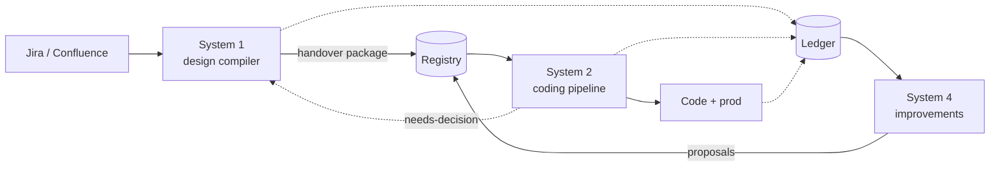
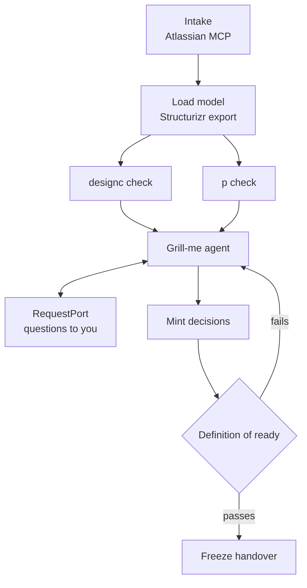
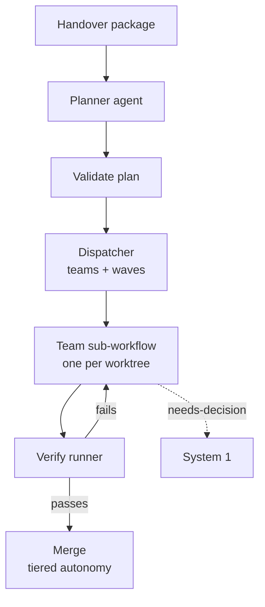
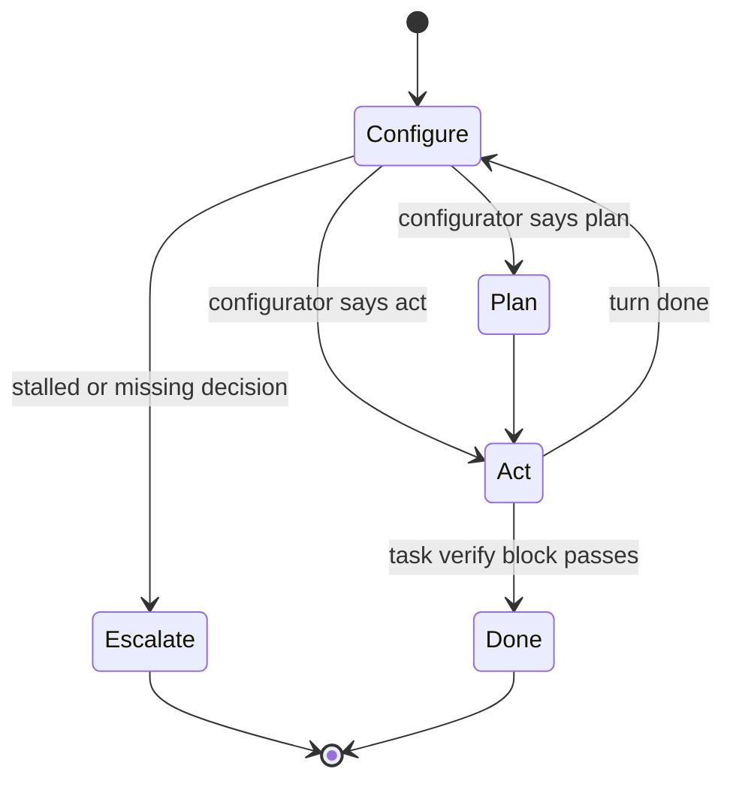
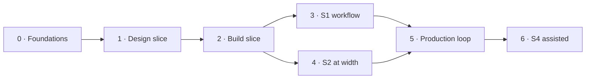

# Design-to-code factory: implementation plan (MAF)

Sep 24, 2026 · @Mike

## Overview

Build three systems on one shared substrate, with MAF workflows as the agent loop in all of them. System 1 decides what to build, System 2 builds it, System 4 decides how Systems 1 and 2 should change.

| System | Input | Output | Done when |
| --- | --- | --- | --- |
| 1 · Design compiler | Jira / Confluence requirements | Frozen handover package in the registry | Definition of ready passes |
| 2 · Coding pipeline | Handover package only | Code (disposable) + ledger entries | Every decision's check passes on merged code |
| 4 · Improvements | Ledger from 1 and 2, production telemetry | Proposals for rules, properties, questions, gates, evals, routing | A human promotes or rejects each proposal |



Solid arrows are the main flow; dotted arrows are evidence. The four rules from the architecture note still hold: design is truth, probabilistic components propose and deterministic ones decide, nothing is done without a check, and an incomplete design cannot be handed over.

**Why MAF.** The org is a C# shop on Azure, MAF is Microsoft's supported agent framework, and AGT plugs into it as native middleware, so mlang-compiled policy governs every tool call with one registration. The rest of this plan uses MAF where agents or long-running, resumable flows are involved, and plain deterministic code everywhere else.

## MAF: what we use, what we build

MAF gives us the loop, the workflow graph, pause-and-resume, and the middleware seam; we build the semantics on top. That is "buy the perimeter, build the semantics" applied to the agent loop. MAF shipped 1.0 on 3 April 2026 as the successor to Semantic Kernel and AutoGen, with .NET and Python SDKs ([Atlan overview](https://atlan.com/know/ai-agent/microsoft/agent-framework/)).

| MAF feature | How we use it |
| --- | --- |
| Agents (`AIAgent`) | Grill-me agent, planner, executor, analyst. One agent per role, never a general agent. |
| Graph workflows (executors + edges, `WorkflowBuilder`) | System 1 design flow and System 2 per-team loop. Deterministic steps are plain executors, not agents. |
| `RequestPort` (human-in-the-loop) | Grill-me questions to you, decision promotion, needs-decision escalation, merge approval ([docs](https://learn.microsoft.com/agent-framework/workflows/human-in-the-loop)). |
| Checkpointing (`ICheckpointStore`, `JsonCheckpointStore`) | Design sessions that span days; pipeline runs that survive restarts ([discussion](https://github.com/microsoft/agent-framework/discussions/2305)). |
| Middleware (`.Use()`) | AGT governance, ledger writer, configurator hook, token accounting. |
| OpenTelemetry | Traces to Langfuse; one telemetry stream for all three systems. |
| MCP client | Atlassian MCP for intake; our own tool gateway (MCP) for tools. |

What we build ourselves: the registry, the ledger, `designc` and the P toolchain wiring, the dispatcher, the verify runner, the configurator client, and the mlang-to-ACS policies per agent role.

### Governance via AGT middleware

AGT integrates with MAF as native middleware: in .NET it is a `.Use()` registration on the agent, evaluated before every tool call ([Microsoft devblog](https://devblogs.microsoft.com/agent-framework/governance-at-the-speed-of-agents-microsoft-agent-framework-and-agent-governance-toolkit-better-together/), [AGT FAQ](https://microsoft.github.io/agent-governance-toolkit/FAQ/)).

```csharp
var grillMe = chatClient.CreateAIAgent(instructions: GrillMePrompt, tools: designTools)
    .AsBuilder()
    .Use(new GovernancePolicyMiddleware(acsEvaluator))   // mlang -> ACS + Rego
    .Use(new LedgerMiddleware(ledger, system: "S1"))       // ours
    .Use(new TokenBudgetMiddleware(budgets))               // ours
    .Build();
```

Open point for the spike: the published sample passes a generic evaluator. We need that evaluator to be the ACS runtime loading mlang's compiled manifests, so confirm the .NET ACS SDK plugs into `GovernancePolicyMiddleware` directly or needs a thin adapter.

### Model access

Agents never call a model provider directly. They use MAF's OpenAI-compatible chat client pointed at the gateway: APIM, then LiteLLM with per-user keys and Langfuse, then Vertex. Cost, budgets and model routing stay in one place.

### Language split

| Layer | Language | Why |
| --- | --- | --- |
| Workflow wiring, agents, middleware | C# | MAF and AGT samples, org skills, least friction |
| Correctness-critical logic: task state machine, dispatcher planning, gate evaluation | F# library called from executors | DUs mirror the P model; illegal states unrepresentable |
| `designc` | Python, invoked as CLI (`python/designc` in the designc desktop repo, `designc check <registry>`) | Exists since 0.1.0; process-per-module boundary. The mlang compiler and evals are not in that repo |
| P models and checker, PObserve | P (.NET) and JVM | Their own toolchains, run as steps |

This replaces the F#-host spike in the architecture note: the host is MAF in C#, and F# earns its place inside it where the types carry the design.

## Shared substrate

Four pieces are shared by all three systems and get built first: the registry, the ledger, the harness package, and the policy set. Everything system-specific sits on top of them.

### Registry (the contract)

A git repo, because decisions need review, history and diffs, and PRs already give us promotion by a human.

```
registry/
  requirements/HRE-1234.yaml        # Jira key, pinned version, source link
  model/workspace.dsl                # Structurizr C4 + d.* properties
  behaviour/quotes-writes.p          # P models, one per protocol
  decisions/D-0042.yaml              # minted -> checked -> bound
  handovers/pricing-v3/              # frozen package, tagged release
  proposals/P-0007.yaml              # from System 4, same lifecycle
  vocabulary/events.yaml             # P event names = logging contract
```

A decision file carries its binding and its check, so the gate can evaluate it mechanically:

```yaml
id: D-0042
status: bound            # minted | checked | bound | superseded
requirement: HRE-1234
binds: ["Pricing Platform/Quotes DB"]
statement: Quote writes use optimistic concurrency (rowversion).
resolves: [DC002]
checks:
  - kind: p
    run: p check -tc tcOptimistic
  - kind: lint
    run: designc check model/workspace.json --only DC002
promoted_by: mike
```

Rules: agents may create files in `decisions/` and `proposals/` with status `minted` only. Moving to `bound` is a merged PR by a human, enforced by branch protection plus an ACS policy on every agent.

### Ledger (the shared memory)

An append-only event table that every system writes and System 4 reads. Start with Postgres (or Azure SQL, whichever the platform team runs); a table with a JSON payload column is enough.

| Field | Example |
| --- | --- |
| `ts`, `run_id`, `trace_id` | links to the Langfuse trace |
| `system`, `stage` | `S1`, `lint` · `S2`, `verify` |
| `kind` | `finding`, `gate`, `decision`, `task`, `rerun`, `needs_decision`, `escape`, `proposal` |
| `requirement`, `element`, `decision` | `HRE-1234`, `Quotes DB`, `D-0042` |
| `code`, `severity`, `outcome` | `DC002`, `error`, `fixed` / `suppressed` / `escaped` |
| `model`, `tokens_in`, `tokens_out`, `cost` | for tokens per passing task |
| `payload` | the full diagnostic, task or trace JSON |

Findings from every source use one envelope, a superset of the `designc` diagnostic JSON. That shared shape is what lets System 4 compare a production escape with the lint findings on the same element.

The architecture note had the dispatcher as the sole ledger writer. Change that: System 1 writes too, through `LedgerMiddleware` on agents and a `LedgerExecutor` on deterministic steps.

### Harness package (`Factory.Harness`)

One NuGet package every agent host references, so all agents are governed and observed the same way:

- `AddFactoryAgent(role)`: builds an MAF agent with the gateway chat client, the role's ACS policy, ledger, token and OTel middleware.
- `IConfigurator`: the Jev/Laya client (System III role) behind one interface; returns plan / act / escalate plus a model tier. Suggests only.
- `ICheckpointStore` implementation on blob storage, so any pod can resume any run.
- Scripted chat client for tests, so harness behaviour is tested without a model.

### Policies (mlang per role)

| Role | Allowed | Denied |
| --- | --- | --- |
| Grill-me (S1) | Read registry, read Jira/Confluence, comment on Jira, create `minted` decisions | Edit Jira issues or Confluence pages, bind decisions, touch code |
| Planner (S2) | Read handover package, write plan files | Write source, change the package |
| Executor (S2) | Write only inside the task's `writes` paths in its worktree, run tests | Anything outside `writes`, network beyond the gateway, git push |
| Analyst (S4) | Read ledger and registry, create `minted` proposals | Write to any rule, prompt, gate or code |

## System 1: design compiler

System 1 is one checkpointed MAF workflow per requirement set, where only grill-me is an agent and every other step is deterministic. It runs for days, pauses on your answers, and ends only when the definition of ready passes.



The loop from the gate back to grill-me is the point: a failing gate produces the next round of questions, not an error.

### Executors

| Executor | Type | Does | Emits to ledger |
| --- | --- | --- | --- |
| `IntakeExecutor` | Deterministic + MCP | Pulls Jira issues and Confluence pages, mints IDs, pins versions, writes `requirements/` | `requirement` events |
| `ModelExecutor` | Deterministic | Runs `structurizr-cli export` on `workspace.dsl`, hashes the result | model version |
| `LintExecutor` | Deterministic | `designc check --format json`; parses diagnostics | one `finding` per diagnostic |
| `BehaviourExecutor` | Deterministic | `p compile` + `p check` per test case; keeps counterexample traces | `finding` per failed property |
| `GrillMeExecutor` | Agent | Turns open findings, counterexamples and untraced requirements into questions; drafts decisions from your answers | questions, drafts |
| `DecisionExecutor` | Deterministic | Writes `minted` decision files, opens the PR for you to promote | `decision` events |
| `ReadyGate` | Deterministic (F#) | Evaluates the definition of ready; returns the list of failing clauses | `gate` event with each clause |
| `HandoverExecutor` | Deterministic | Tags a frozen package: pinned requirements, model, P, bound decisions, vocabulary | `handover` event |

### Grill-me in practice

Grill-me gets a structured brief, not a chat history: the requirement text, the C4 fragment the requirement touches, open findings with their hints, and P counterexamples summarised as event sequences. It asks one question at a time through the `RequestPort`. Questions only the business can answer go to Jira as a comment; the workflow checkpoints and waits.

For the Quote example it would receive DC002 plus the `tcNoControl` trace and ask: "Pricing API and Referral Worker both write Quote. Should one own it, or should both write with optimistic concurrency?" Your answer becomes draft D-0042 with `tcOptimistic` as its check.

### Definition of ready (F#)

The gate is a pure function from registry state to a verdict, so it is testable and cannot be argued with by an agent:

```fsharp
type Clause =
  | UntracedRequirement of RequirementId
  | OpenFinding of Diagnostic
  | UncheckedDecision of DecisionId
  | FailingProperty of PTest
  | OpenNeedsDecision of ItemId

type Verdict = Ready of HandoverId | NotReady of Clause list

let evaluate (s: RegistrySnapshot) : Verdict = ...
```

### Input drift

A scheduled executor compares pinned Jira and Confluence versions with the live ones. A change reopens the decisions bound to that requirement and starts a new grill-me round. The grill-me ACS policy denies editing issues or pages; it can only comment.

### Deliverables

- [ ] `designc` run against the real pricing engine model, results recorded
- [ ] P model for Quote writes with `tcNoControl` failing and `tcOptimistic` passing
- [ ] Registry repo with the schema above and branch protection on `bound`
- [ ] `ReadyGate` in F# with tests per clause
- [ ] MAF workflow with checkpointing to blob storage and `RequestPort` for questions
- [ ] Grill-me agent with its ACS policy and a scripted-model test
- [ ] Atlassian MCP intake and drift check

## System 2: coding pipeline

System 2 is two layers: a deterministic outer workflow that plans, dispatches, verifies and merges, and one MAF sub-workflow per team where the agents work. Agents write code; they never decide whether it passes.



### Outer workflow

| Step | Type | Does |
| --- | --- | --- |
| `PlannerExecutor` | Agent | Turns the package into tasks: `writes` paths, C4 element IDs, dependencies, verify blocks. P traces become verify blocks. |
| `PlanValidator` | Deterministic (F#) | Rejects a plan where a task has no verify block, a bound decision has no task covering its check, or `writes` paths fall outside the element's code area. |
| `Dispatcher` | Deterministic (F#) | Groups tasks with overlapping `writes` into teams, orders dependency waves, creates one worktree per team. |
| `VerifyRunner` | Deterministic | Runs verify blocks, unit tests, the decision checks from the registry, and PObserve over the test logs. |
| `MergeExecutor` | Deterministic + `RequestPort` | Opens the PR; tier decides auto-merge or a human approval request. |

The architecture note had the dispatcher as a Go command. Folding it into the F# library keeps one runtime and lets the dispatcher share types with the gate; keep Go only if the existing reconcile command is already worth more than that.

### Team sub-workflow (the harness loop)



Each state is an executor. `Configure` calls `IConfigurator` (Jev or Laya) for plan, act or escalate plus a model tier; it only routes. `Plan` is the frontier-model planner, `Act` the cheaper executor model. `Escalate` sends a needs-decision through a `RequestPort` into System 1's registry and checkpoints the team; the team resumes when the decision is bound.

The task state is an F# DU, so the P model of the pipeline and the code share one shape:

```fsharp
type TaskState =
  | Queued
  | Running of turn: int * tier: ModelTier
  | Blocked of NeedsDecision
  | Verifying of attempt: int
  | Passed of PassedEvidence
  | Failed of FailureReason
```

### Code is disposable: enforcement

- The executor's ACS policy allows writes only inside the task's `writes` paths in its own worktree.
- The only path to `main` is `MergeExecutor`; branch protection blocks direct pushes, hotfixes included.
- A regeneration drill runs on a schedule: delete one component, rerun its tasks from the package, and require every check to pass. The result goes to the ledger.

### Metrics from day one

Tokens per passing task, reruns per task, and turns per task, split by model tier and configurator choice. The ledger records all three; nothing gets optimised before they exist.

### Deliverables

- [ ] k-rerun diagnostic on the 11 existing tasks, classified spec problem or runtime problem
- [ ] Plan schema with `writes`, element IDs and verify blocks, plus `PlanValidator`
- [ ] Dispatcher in F# with tests for team grouping and waves
- [ ] Team sub-workflow with scripted-model tests for each transition
- [ ] `VerifyRunner` including registry decision checks and PObserve on test logs
- [ ] Merge tiers wired to GitHub with approval via `RequestPort`
- [ ] Regeneration drill for one component

## System 4: improvements

System 4 fixes the factory, not the product, and starts as a weekly review you run by hand from ledger queries. It becomes an MAF workflow only once the review shows which patterns recur.

### Escape classification

Every problem is classified by the earliest stage that should have caught it. The escape rate per stage is System 4's headline metric; a falling finding count on its own means nothing.

| Observed | Should have been caught by | Typical proposal |
| --- | --- | --- |
| PObserve violation in production, no property covered it | System 1 (P) | New P property template for that protocol shape |
| Incident on an element with no lint finding | System 1 (lint) | New `designc` rule with `source=` the incident |
| Verify fails after a clean handover | System 1 (grill-me / gate) | New grill-me question or a tighter gate clause |
| Reruns on a task whose spec was complete | System 2 (runtime) | Routing, prompt or tool change; eval case from the trace |
| Configurator chose act, task stalled | System 2 (configurator) | Recalibration data point for Jev / Laya |
| Suppression later linked to an incident | System 1 (review) | Revisit the accepted risk; tighten suppression rules |

### Phase A: manual (starts with the first slice)

1. A saved set of ledger queries: findings by code and outcome, reruns per task, needs-decision count, suppressions, escapes.
2. A weekly 30-minute review where you classify new problems with the table above.
3. Proposals written by hand as `proposals/P-nnnn.yaml`, same lifecycle as decisions: minted, checked, bound.
4. A proposal's check proves the improvement: a new lint rule must fire on the model that motivated it; a new eval case must fail on the old prompt.

### Phase B: assisted (after about 8 weekly reviews)

An MAF workflow on a schedule: `LedgerQueryExecutor` (deterministic) → `ClassifierExecutor` (deterministic rules first, agent for leftovers) → `AnalystAgent` (drafts proposals with evidence links) → `RequestPort` to you. The analyst's ACS policy allows reading and minting proposals only; it can never change a rule, prompt, gate or model route itself.

### Guarding against Goodhart

- Measure escapes, never raw finding counts; a system can hit zero findings by loosening rules.
- Every rule and property keeps its `source`; a proposal to remove one must cite evidence that it produced only noise.
- Track false positives per rule; a rule over an agreed noise threshold gets reviewed, not silently dropped.

### Deliverables

- [ ] Ledger queries for the weekly review
- [ ] Escape classification recorded as a ledger event
- [ ] Proposal schema and lifecycle in the registry
- [ ] First incident-sourced lint rule or P property through the full loop
- [ ] Phase B workflow and analyst policy, only after recurring patterns are visible

## Roadmap

Build one thin vertical slice through all three systems before widening any of them: the Quote concurrent-writes slice goes from requirement to regenerated code in Phase 2. Sizes are relative (S about a week, M two to three, L four or more) for one engineer, and assume no parallel help.

| Phase | Scope | Size | Exit criteria |
| --- | --- | --- | --- |
| 0 · Foundations | MAF host spike: one agent via the gateway, AGT middleware with an mlang-compiled ACS policy, one Jev call, one ledger write, trace in Langfuse. F# executor inside a C# workflow. k-rerun diagnostic on the 11 tasks. | M | Spike decision recorded in the registry; ACS evaluator plugs into MAF middleware; rerun causes classified |
| 1 · Design slice (manual S1) | Real pricing-engine model in Structurizr with `d.*` properties; `designc` run; Quote P model; registry repo; D-0042 bound; `ReadyGate` in F#. Grill-me is you, by hand. System 4 review starts. | M | DC002 fires on the real model (or the miss is explained); `tcNoControl` fails, `tcOptimistic` passes; gate returns Ready |
| 2 · Build slice (minimal S2) | Planner agent + `PlanValidator`, one team, executor agent in one worktree, `VerifyRunner` with the decision check, PR opened. Regeneration drill on the slice. | L | Fix merged with every check passing; regenerated component passes again; tokens per passing task recorded |
| 3 · S1 as a workflow | MAF workflow with checkpointing, grill-me agent with `RequestPort`, Atlassian intake, decision PRs, drift check. | L | A second requirement goes from Jira to handover with the agent asking the questions; resumes after a restart |
| 4 · S2 at width | Dispatcher with teams and waves, team sub-workflow with configurator, needs-decision escalation, merge tiers. | L | Multi-team handover built in parallel; an escalation round-trips through System 1 |
| 5 · Production loop | PObserve on production logs, overseer view from the ledger, drift report. | M | A production event stream is checked against at least one P monitor |
| 6 · S4 assisted | Phase B workflow and analyst agent, only if the manual reviews show recurring patterns. | M | First proposal drafted by the analyst, promoted by you, and verified by its check |



Phases 3 and 4 can run in parallel once someone else joins. The manual System 4 review runs continuously from Phase 1, so the automation in Phase 6 is built from real patterns rather than guesses.

### First two weeks

- [ ] Stand up the MAF host spike against the LiteLLM gateway
- [ ] Wire `GovernancePolicyMiddleware` to an ACS evaluator loading one mlang-compiled manifest
- [ ] Write one `LedgerMiddleware` event to Postgres and see the trace in Langfuse
- [ ] Call an F# function from a C# executor and checkpoint the workflow
- [ ] Run the k-rerun diagnostic and classify the 11 tasks
- [ ] Model the real pricing engine's Quote writes in Structurizr and run `designc`

## Risks and open decisions

The biggest risk is scope, not technology: this is a multi-person platform planned for one engineer. The phase plan keeps each step useful on its own so that it can stop anywhere and still have paid off.

### Risks

| Risk | Impact | Mitigation |
| --- | --- | --- |
| One engineer, many systems | Nothing reaches production | Vertical slice first; each phase is usable alone; recruit help at Phase 3 using the slice as the demo |
| MAF checkpointing edge cases: a reported .NET bug when checkpointing handoff orchestrations ([issue #5621](https://github.com/microsoft/agent-framework/issues/5621)) | Runs fail to resume | Use custom `WorkflowBuilder` graphs, not handoff or group-chat orchestrations; test resume in Phase 0 |
| ACS evaluator does not slot into MAF middleware as-is | Governance gap on tool calls | Phase 0 exit criterion; fall back to a thin adapter calling the .NET ACS SDK |
| F# with MAF executors is awkward | Friction in the core | Keep F# as a pure library called from C# executors; no F# executors required |
| P model fidelity | A passing model gives false confidence | You review every P model; PObserve on real logs checks the model against reality |
| Annotation fatigue in `d.*` properties | Designers stop annotating | Demand-driven properties only; measure unknown counts per model |
| Jev / Laya claims are new and self-reported | Bad routing, wasted tokens | They suggest only; calibrate against ledger outcomes before trusting thresholds |
| Token budget of about £750 per dev per month | Pipeline throttled | Tokens per passing task from Phase 2; reruns are the main cost lever |

### Open decisions

- [ ] Ledger store: Postgres or Azure SQL, based on what the platform team already runs.
- [ ] Checkpoint store: blob storage per run, or the ledger database.
- [ ] Dispatcher: F# library in the host, or keep the Go reconcile command.
- [ ] Registry host: its own repo, or a folder in each product repo.
- [ ] How a check is expressed in the registry beyond `run:` commands (for example a reference to a test ID).
- [ ] Can impl plan tasks carry C4 element IDs today, or is it a new field like `writes`?
- [ ] Atlassian auth: OAuth 2.1 versus API tokens, and IP allowlisting.
- [ ] Naming: System 4 is settled for the improvements system; rename the harness roles to configurator, planner and executor to avoid the System III clash.

## Sources

- [Governance at the Speed of Agents: Microsoft Agent Framework and Agent Governance Toolkit, Better Together](https://devblogs.microsoft.com/agent-framework/governance-at-the-speed-of-agents-microsoft-agent-framework-and-agent-governance-toolkit-better-together/) (Microsoft devblog, May 2026)
- [Agent Governance Toolkit FAQ: framework integration types](https://microsoft.github.io/agent-governance-toolkit/FAQ/)
- [Agent Governance Toolkit repository](https://github.com/microsoft/agent-governance-toolkit)
- [ACS policy engine README](https://github.com/microsoft/agent-governance-toolkit/blob/main/policy-engine/README.md)
- [MAF workflows: human-in-the-loop and RequestPort](https://learn.microsoft.com/agent-framework/workflows/human-in-the-loop)
- [MAF discussion #2305: externalising checkpoints with ICheckpointStore](https://github.com/microsoft/agent-framework/discussions/2305)
- [MAF issue #5621: checkpointing in handoff workflows](https://github.com/microsoft/agent-framework/issues/5621)
- [Microsoft Agent Framework: features, status and gaps in 2026](https://atlan.com/know/ai-agent/microsoft/agent-framework/) (Atlan)
- [Microsoft.Agents.AI.Abstractions on NuGet](https://www.nuget.org/packages/Microsoft.Agents.AI.Abstractions)
- [P language](https://github.com/p-org/P)
