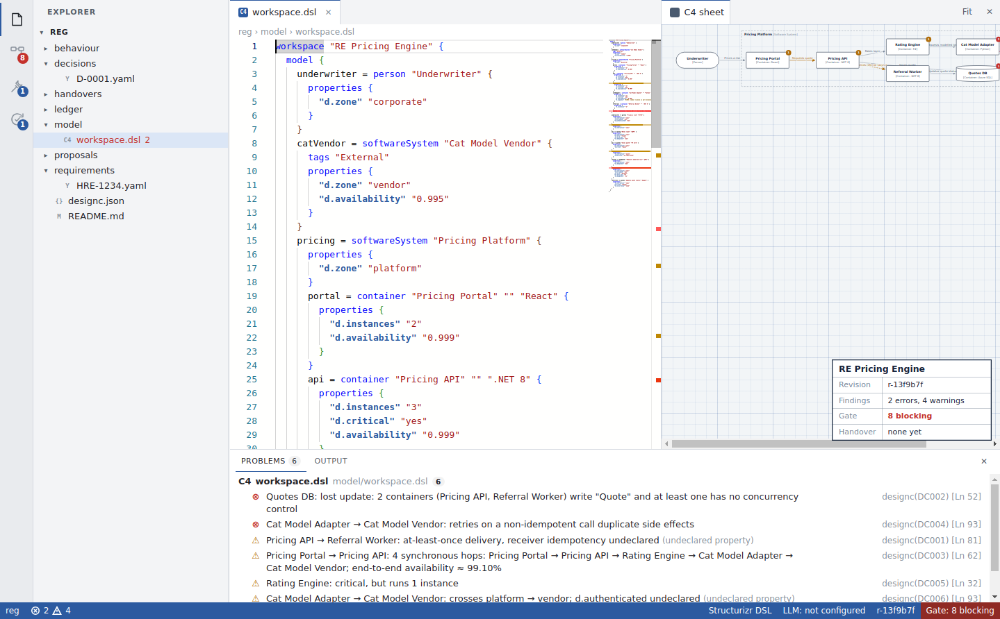
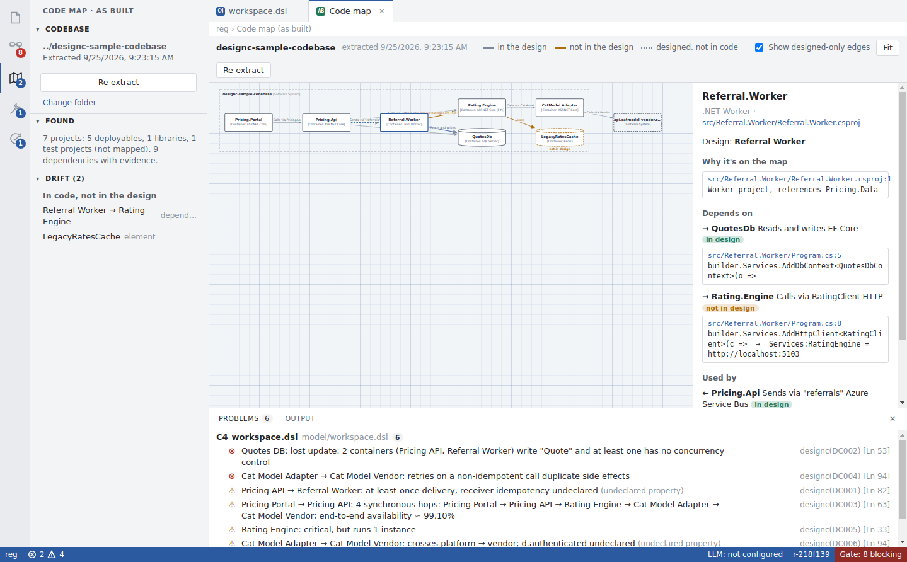
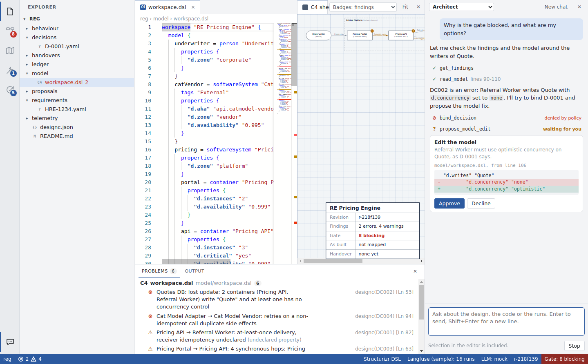

# designc desktop

A system design IDE. The design is the source; code is a build output.
It opens a **registry folder** and gives you the three systems in one window:

- **Design (System 1):** a Structurizr DSL editor (Monaco, the VS Code editor engine) with live lint (DC000 to DC006) as squiggles, completions and hovers for `d.*` properties, a C4 sheet beside it, decisions and requirements as YAML files, the definition-of-ready gate, grill-me, and handover.
- **Build (System 2):** live agent runs from Langfuse, plus what the pipeline recorded in `ledger/*.jsonl`: tokens per passing task, reruns, each decision's latest check result, items waiting on a decision, and as-built vs designed drift.
- **Code map (as built):** a C4 map of an existing codebase, extracted deterministically from the repo, overlaid on the design so drift is visible. Every box and arrow links to the lines of code that prove it.
- **Agent panel:** a chat pane like Copilot's with three roles (Architect, Grill-me, Analyst). Model-agnostic: use the built-in agent with any model your gateway routes, or plug in any ACP agent (Claude Code, Codex, Gemini CLI, Copilot, your own). Either way it reads the workspace and every change waits for your approval.
- **Improve (System 4):** escapes by the stage that should have caught them, rule health, and proposals as YAML files.



## Run it

Needs Node 20 or later.

```
npm install
npm start                      # opens the app
npm start -- /path/to/registry # opens straight into a folder
```

File > Open Sample Registry copies a worked example (the pricing engine design, plus a small .NET solution to map) to your Documents folder and opens it.

## Build an installer

```
npm run dist:win    # dist/designc Setup 0.1.0.exe
npm run dist:mac    # dist/designc-0.1.0.dmg
npm run dist:linux  # dist/designc-0.1.0.AppImage
```

The installers are unsigned. On a managed Windows machine SmartScreen or Intune may block them until the build is signed with a company certificate (set `CSC_LINK` and `CSC_KEY_PASSWORD` for electron-builder), so check with IT before handing it to others.

## Code map

Set `"codebase"` in `designc.json` (or use the Code map view's "Choose codebase folder"), then Run > Extract Code Map (Ctrl+Shift+R). The codebase is only read, never changed. The result is written to `asbuilt/workspace.dsl` and `asbuilt/facts.json` in the registry, so extractions are versioned with everything else, and an `extraction` event goes to the ledger.



The .NET extractor reads:

| Source | Becomes |
| --- | --- |
| Web, Worker and Exe projects (`.csproj`, `.fsproj`) | Containers. Libraries fold into the deployables that reference them; test projects are skipped |
| EF Core `DbContext` classes | Stores, with the provider from `UseSqlServer` etc., linked to deployables that use them |
| Redis, Blob and Cosmos clients | Stores, named by connection string |
| `AddHttpClient` with a base address from appsettings | Sync edges, matched to projects by launch port or name; other hosts become external systems |
| Service Bus `CreateSender` / `CreateProcessor` | Async edges, matched on queue or topic name |

It never guesses. Anything it sees but can't tie to an element, such as a queue with no consumer in the repo or an HTTP client whose URL matches nothing, is listed under **Unresolved** with its file and line, not drawn.

Matching to the design is by normalised name (`Referral.Worker` matches `Referral Worker`). When code and design use different names for the same thing, put `"d.aka" "<code name>"` on the designed element. Drift appears in the Code map sidebar, as amber on the map, in the sheet's title block, and in the Build dashboard:

- **In code, not in the design:** an undeclared dependency, or an element the design doesn't have.
- **Designed, not found in code:** dotted edges on the map, and designed elements with no match.

With no design yet, "Start the design from this map" turns the as-built model into `model/workspace.dsl`, which is the quickest way into a legacy codebase.

## Langfuse (Build and Improve)

designc reads agent runs from Langfuse and ties each one to the design: which element it worked on, which task and decision it served, how many attempts it took, what it cost, and why it failed.

- **Build:** tokens per passing task, pass rate, cost per element, recent failed runs with a link into Langfuse, and tagging gaps (runs that can't be tied to the design).
- **Design sheet:** the badge menu switches boxes between lint findings, agent failures and agent cost.
- **Improve:** tasks that took three or more attempts, failed or escalated are suggested as escapes; one click records one in the ledger with its trace ids.

It uses the **Observations API v2** and **Scores API v3**. The older `GET /api/public/traces` and v1 observations reads stop working on Langfuse Cloud on 16 November 2026 and on self-hosted v4, so nothing here depends on them. Self-hosted Langfuse v3 doesn't have the v2 API; the app says so if it gets a 404.

### Settings

```json
"langfuse": {
  "baseUrl": "https://cloud.langfuse.com",
  "publicKeyEnv": "LANGFUSE_PUBLIC_KEY",
  "secretKeyEnv": "LANGFUSE_SECRET_KEY",
  "lookbackDays": 14,
  "tags": ["designc"],
  "fields": { "system": "system", "element": "element", "task": "task", "decision": "decision", "outcome": "outcome", "attempt": "attempt" },
  "outcomeScore": "task_passed",
  "sampleFile": ""
}
```

Keys come from the environment variables named here, never from the repo. `sampleFile` loads a local file in the same response shapes instead of calling Langfuse; the sample registry uses it, and it's ignored once real keys are set.

### The assumptions, and how to change them

| Assumption | Default | If yours differs |
| --- | --- | --- |
| Runs are tagged | `designc` | Set `tags` to your tag, or `[]` to read every trace |
| Trace metadata names the design element | `element` | Set `fields.element` to your key |
| …and the task, decision, system, attempt | `task`, `decision`, `system`, `attempt` | Set the matching `fields` entries |
| Pass or fail | `outcome` metadata, else a `task_passed` score (1 = passed), else "error" if any observation is ERROR | Change `fields.outcome` or `outcomeScore` |
| Element names match the design | Normalised name match, or `d.aka` | Add `d.aka` on designed elements |
| Cost | Langfuse's `totalCost`, shown in dollars | — |

The .NET side of the convention for the MAF harness is in `integrations/DesigncTelemetry.cs`: a `BeginRun` scope that puts the keys in OpenTelemetry baggage, and a processor that copies them onto every span as `langfuse.trace.metadata.*` with the `designc` tag. It is a sketch, not compiled here, so check the source names against your MAF version.

## Agent panel

Ctrl+Alt+I, or the chat icon at the bottom of the activity bar. Pick a role:




| Role | System | Reads | Needs your approval |
| --- | --- | --- | --- |
| Architect | S1 | model, findings, gate, decisions, registry files, code map, codebase search, telemetry | `propose_model_edit`, `mint_decision` |
| Grill-me | S1 | the same, without telemetry | `mint_decision` |
| Analyst | S4 | everything above | `mint_proposal` |

How it stays governed:

- **Fail closed.** A role can only call tools it lists; anything else, including made-up tool names, is refused and the refusal goes back to the model. Deny always wins.
- **Validate, then ask.** A model edit is checked deterministically first (its `find` must match the model exactly once); only a valid change reaches you, as a diff.
- **Nothing is written without Approve.** Decisions and proposals are created as `minted`. Binding stays a human action outside the panel, and no agent can run checks, edit code or touch the ledger directly.
- **Everything is recorded.** Every tool call (allowed, denied, approved, declined) and every turn's token count goes to `ledger/agents.jsonl`, so System 4 and the value metrics can see what the agents did.

The panel includes your editor selection and a short workspace summary with each message. It talks to the same OpenAI-compatible gateway as grill-me (`llm` in `designc.json`); the model must support tool calling. Per-role overrides:

```json
"agents": {
  "architect": { "model": "claude-opus", "instructions": "Prefer ownership over locking for new entities." },
  "analyst": { "deny": ["search_codebase"] }
},
"llm": { "baseUrl": "…", "model": "claude-sonnet", "apiKeyEnv": "DESIGNC_LLM_API_KEY", "litellmMetadata": true }
```

`litellmMetadata` adds LiteLLM's `metadata` (tags `designc` and `ide-agent`, the role and session) so IDE agent turns land in Langfuse under the same convention. Leave it off for gateways that reject unknown fields.

### Any agent, any model: ACP

The agent menu at the top of the panel lists two kinds of agent:

- **designc (gateway):** the built-in loop above. It is model-agnostic through the gateway: any model LiteLLM routes that supports tool calling.
- **ACP agents:** any agent that speaks the [Agent Client Protocol](https://agentclientprotocol.com). designc is the ACP client; the agent runs as its own process with its own model and login. Presets:

| Agent | Command |
| --- | --- |
| Claude Code | `npx -y @agentclientprotocol/claude-agent-acp` |
| Codex | `npx -y @zed-industries/codex-acp` |
| Gemini CLI | `npx -y @google/gemini-cli --acp` |
| GitHub Copilot | `copilot --acp --stdio` |

Adapter package names move quickly; if a preset fails to start, check the agent's docs or the ACP registry. Add or override agents in `designc.json`; a MAF host with an ACP adapter plugs in the same way:

```json
"acpAgents": {
  "maf": { "label": "MAF harness", "command": "dotnet", "args": ["run", "--project", "../harness/Designc.AcpHost"] },
  "gemini": { "enabled": false }
}
```

What designc does for an ACP agent:

- Starts it with the registry as its working directory and speaks ACP v1 over stdio (newline-delimited JSON-RPC). Tool calls are treated as upserts, so a v2 agent's `tool_call_update` stream renders too.
- **Gives it designc's tools as an MCP server** named `designc`: the same tools as the built-in agent, filtered by the selected role. The server is a small stdio process (`designc-mcp.js`, run with Electron's own Node) that forwards to the running app over 127.0.0.1 with a per-run token, so the role policy and approval cards apply unchanged.
- **Shows its permission requests** (`session/request_permission`) as cards with the agent's own options, such as Allow once or Reject.
- **Governs file writes** (`fs/write_text_file`): writes outside the registry are refused (the codebase is read-only here; code changes go through the coding pipeline), each role may only write its own folders (Architect: `model/` and `decisions/`; Grill-me: `decisions/`; Analyst: `proposals/`), a decision can't be written as bound, and everything else is a diff you approve.
- **Lets it read** the registry and the configured codebase through `fs/read_text_file`, nothing else.
- **Flags bypasses.** An external agent can still change files directly with its own tools. Anything that changes in the registry during an ACP turn without an approved write is flagged in the panel and recorded as `unapproved_change` in the ledger.
- **Records** its tool calls, permission answers, writes and turns in `ledger/agents.jsonl`, tagged with the agent name, next to the built-in agent's.

The limit to be clear about: designc governs everything that flows through ACP and its own MCP tools. It does not sandbox the agent process. What an agent does with its own native tools depends on that agent's permission settings, so leave its auto-approve modes off, and run it inside the MAF harness under ACS where you need hard enforcement rather than detection.

For offline demos, `dev/mock-acp-agent.js` is a scripted ACP agent that uses the MCP bridge, asks permission, writes through the client and tries a write the policy refuses:

```json
"acpAgents": { "mock": { "label": "Mock agent", "command": "node", "args": ["<path>/dev/mock-acp-agent.js"] } }
```

### Your own agents as services: AG-UI

The third kind of agent is a remote service that speaks [AG-UI](https://docs.ag-ui.com/introduction), typically a MAF host exposing agents with `MapAGUIServer`. This is the governed path: the agent's own tools run in the host under ACS, so enforcement happens there rather than being detected afterwards.

```json
"aguiAgents": {
  "maf-architect": { "label": "Architect (MAF)", "url": "http://127.0.0.1:5100/architect",
                     "headers": { "Authorization": "Bearer ${env:DESIGNC_MAF_TOKEN}" },
                     "clientTools": true, "sendState": true }
}
```

Header values can reference environment variables as `${env:NAME}`, so tokens stay out of the repo.

Each run POSTs the conversation, designc's tools as **frontend tools** (the same role-filtered tools as the other agents), the design as **shared state** (model revision, findings, gate, drift, decisions) and the role instructions as **context**. designc then:

- streams text, reasoning, steps and backend tool calls with their results;
- keeps the agent's own state from `STATE_SNAPSHOT` and `STATE_DELTA` (shown under "Agent state");
- runs frontend tools the agent calls under the role policy and approval cards, once per tool call id, and sends the results in the next run;
- turns a `RUN_FINISHED` interrupt (MAF's `ApprovalRequiredAIFunction` produces `reason: "tool_call"` with the function call in `metadata.agent_framework`) into an approval card, then resumes the thread with `resume: [{ interruptId, status: "resolved", payload: { accepted } }]`, or `status: "cancelled"` on Stop. Each interrupt is resolved at most once;
- records runs, frontend tool calls and approvals in `ledger/agents.jsonl` with `via: "agui"`;
- allows registry writes by the host for 30 seconds after an approval; any other registry change during the turn is flagged as `unapproved_change`.

`integrations/maf-agui-host/` is a sketch of the host (Grill-me and Architect, gateway client, registry tools with approval-gated writes, bearer check). It has not been compiled. For offline demos, `dev/mock-agui-server.js` behaves like a MAF host: frontend tool call, backend tool, shared state, and an approval interrupt that only writes after the resume says accepted.

| Agent kind | Where the loop runs | Governance | Best for |
| --- | --- | --- | --- |
| designc (gateway) | Inside the app | App policy and approvals | Quick use with any model |
| ACP | The agent's own process | Policy on what crosses ACP; bypasses detected | Off-the-shelf coding agents |
| AG-UI | Your agent service (MAF) | ACS in the host; approvals in designc | Your governed agents, shared with the pipeline |

This built-in loop runs inside the app, not on MAF. It uses the same contract as the MAF harness (role, tools, policy, ledger), so the panel can later be pointed at a MAF host instead, for example over AG-UI, without changing the UI.

For offline demos, `node dev/mock-gateway.js` serves a scripted session: set `llm.baseUrl` to `http://127.0.0.1:8765/v1`, `llm.model` to `mock` and `DESIGNC_LLM_API_KEY` to anything.

## The registry folder

| Path | Holds |
| --- | --- |
| `model/workspace.dsl` | C4 model with `d.*` design properties |
| `behaviour/*.p` | P models, one per protocol |
| `requirements/*.yaml` | Jira keys the design answers |
| `decisions/*.yaml` | Decisions: `minted`, then `bound` by a human, each with `checks` |
| `proposals/*.yaml` | System 4 proposals, same lifecycle |
| `handovers/*.yaml` | Frozen handovers, written by Run > Freeze Handover |
| `asbuilt/` | The last code-map extraction: `workspace.dsl` and `facts.json` with evidence |
| `telemetry/` | Sample Langfuse data (sample registry only) |
| `ledger/*.jsonl` | Append-only events, one JSON object per line: `checks.jsonl`, `pipeline.jsonl`, `designc.jsonl`, `agents.jsonl` hold designc envelope v1 events; `sessions.jsonl` holds harness envelope v1 records (grill-me / MAF session and charter events, adopted as-is) |
| `designc.json` | Settings |

Everything is plain files, so git is the review and history layer: binding a decision is an edit you commit and review like any other.

### Ledger events

The pipeline appends lines like these; the app watches the folder and updates live.

```json
{"schema_version":1,"by":"pipeline","kind":"task","task":"T-01","element":"Quotes DB","status":"passed","reruns":0,"turns":9,"tokens_in":48000,"tokens_out":13000,"cost":0.42,"model":"sonnet"}
{"schema_version":1,"by":"pipeline","kind":"check","decision":"D-0001","check":"p check -tc tcOptimistic","outcome":"pass","source":"pipeline"}
{"schema_version":1,"by":"pipeline","kind":"needs_decision","id":"ND-0003","task":"T-06","element":"Referral Worker","question":"…","status":"open"}
{"schema_version":1,"by":"pipeline","kind":"asbuilt_edge","from":"ReferralWorker","to":"RatingEngine"}
{"schema_version":1,"by":"pipeline","kind":"escape","id":"E-0008","element":"Cat Model Adapter","description":"…","code":"DC004"}
{"schema_version":1,"by":"pipeline","kind":"false_positive","code":"DC003","element":"Pricing Portal"}
```

`event_id` and `ts` are optional for external (pipeline) writers — the app's single append path stamps them if missing. Token spend on a `task` splits as `tokens_in`/`tokens_out` (`Ledger.totalTokens` sums them) plus an optional `cost`; the older single `tokens` field is still read. `escape` and `escape_classified` use `code`/`caught_by` as of the v1 envelope; older pipeline output using `rule`/`stage` is still read (upcast on load), just no longer written.

The app itself only appends: check results to `ledger/checks.jsonl`, and handovers, escape classifications and resolved needs-decisions to `ledger/designc.jsonl`. It never rewrites a ledger line.

## Settings (`designc.json`)

```json
{
  "model": "model/workspace.dsl",
  "chainHops": 4,
  "llm": { "baseUrl": "https://your-gateway/v1", "model": "claude-sonnet", "apiKeyEnv": "DESIGNC_LLM_API_KEY" }
}
```

Grill-me and proposal drafting call an OpenAI-compatible `/chat/completions` endpoint, so point `baseUrl` at the LiteLLM gateway. The key is read from the environment variable named in `apiKeyEnv` and never stored in the repo. Without these set, everything else works and those two buttons tell you what is missing.

## Command line (CI)

The same compiler and gate run without the app, for CI. It needs Python 3.9 or later and PyYAML:

```
cd python
python3 -m designc check /path/to/registry          # findings and gate clauses
python3 -m designc check /path/to/registry --json   # the same as JSON
```

Exit code 0 means ready for handover, 1 means the gate is blocked, 2 means the folder could not be read. It does not do drift, diff, blast radius or code extraction; those stay in the app.

## Decision checks run on your machine

Run > Run All Decision Checks (Ctrl+Shift+B) runs each decision's `checks` as shell commands in the registry folder, writes pass or fail to the ledger, and streams output to the Output panel. Because those commands come from the repository, the app asks you to trust a folder the first time, like VS Code's workspace trust. Only trust folders whose decisions you'd be willing to run.

To stop being asked, set `"trustAllFolders": true` in `state.json` in the app's user data folder. It is deliberately not a `designc.json` setting, because that file comes with the repository.

## Keys

| Keys | Does |
| --- | --- |
| Ctrl+O | Open folder |
| Ctrl+S | Save |
| Ctrl+. | Quick fix: record a decision for the problem under the cursor |
| Ctrl+Shift+B | Run all decision checks |
| Ctrl+Shift+G | Ask grill-me |
| Ctrl+Alt+V | Toggle the C4 sheet |
| Ctrl+Alt+I | Agent panel |
| Ctrl+Shift+K | Code map |
| Ctrl+Shift+R | Extract the code map |
| Ctrl+Shift+M / U | Problems / Output panel |

## Layout of the code

| File | Role |
| --- | --- |
| `extract.js` | Deterministic .NET extractor: projects, stores, HTTP and Service Bus edges, each with evidence |
| `telemetry.js` | Langfuse reader: Observations v2 and Scores v3, grouped into runs |
| `integrations/DesigncTelemetry.cs` | The tagging convention for the .NET harness |
| `main.js` | Main process: folder-scoped file access, watcher, ledger appends, check runs, gateway calls |
| `preload.js` | The only bridge to the UI (context isolation on, Node off in the renderer) |
| `renderer/core.js` | The design compiler: DSL parser, DC000 to DC006, gate, drift. Same rules and results as the Python CLI in `python/designc` |
| `renderer/agent.js` | Agent panel: roles, fail-closed policy, tools, approvals, streaming loop |
| `acp.js` | ACP client: spawns agents, JSON-RPC over stdio, routes updates, permissions and file requests |
| `designc-mcp.js` | Stdio MCP server that gives ACP agents designc's tools via the running app |
| `dev/mock-gateway.js` | Scripted OpenAI-compatible gateway for demos and tests |
| `dev/mock-acp-agent.js` | Scripted ACP agent for demos and tests |
| `dev/mock-agui-server.js` | Scripted AG-UI service shaped like a MAF host, for demos and tests |
| `integrations/maf-agui-host/` | Sketch of the MAF host exposing designc's agents over AG-UI |
| `renderer/app.js` | Workbench: Monaco setup, views, panels, sheet, dashboards |

Headless screenshots for docs or CI: `DESIGNC_SNAPSHOT=out/shot DESIGNC_STEPS='[]' xvfb-run npx electron . --no-sandbox /path/to/registry`.
