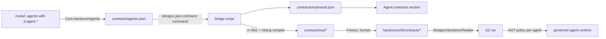

# Agent contracts: tech spec

Status: proposed. Stage 1 is built (designc commit `4b18f61`): `agents.json`, the `contracts` command, `result.json`, the sidebar section. This spec covers the rest: copying compiled contracts into a handover, S2 enforcing them, and the bridge to M.

Principle kept: probabilistic components propose; deterministic components and humans decide. A contract is deterministic input; a person freezes it; S2 refuses to run without it.

## The whole picture



## 1. Result contract v2 (additive)

`result.json` gains, all required for freeze (optional for display today):

| Field | Meaning |
| --- | --- |
| `agents_hash` | `hash16` of the exact `contracts/agents.json` text the command was given. Proves the output is for the current design |
| `compiler` | `{name, version}`, free text, shown and recorded |
| per agent `policy` | Registry-relative path of the AGT policy file for that agent (required when `compiled`) |
| per agent `files` | Every file belonging to the contract (policy, agis, sdk, invariants, jacket) |

Schema id becomes `designc.contracts.result/2`; `/1` stays readable (display only, never freezable).

## 2. Freeze copies the contracts (designc)

`freezeHandover` (human action, unchanged entry points) gains a step, only when `designc.json` `contracts` is set and the design has agents:

1. Read `contracts/out/result.json`. Refuse with a plain message if: missing, schema `/1`, `agents_hash` differs from `hash16` of a fresh `Core.handoverAgents` text (the design moved: "Compile contracts again"), any file listed is missing or outside `contracts/out/`.
2. Every agent must be `compiled`, except agents with `d.agent.autonomy "suggest"` (they may be `needs_input` or absent; recorded as `uncontracted`). `needs_input` or `failed` on any other agent refuses the freeze and names the reasons.
3. `Core.handoverPlan({contracts: [{path, text}], contractsResult})` copies each file verbatim to `contracts/<path-under-out>` in the handover and lists path and hash in `handover.yaml` like every frozen file. `handover.yaml` gets `contracts: {result: contracts/result.json, agents: {<agentId>: <policy path>}, uncontracted: [ids], compiler: {...}}`.
4. These files are inside the id hash. A different policy is a different handover; the same design recompiled by a changed compiler gives a new id, which is correct (different enforcement).
5. `agents.json` stays outside the id (derived from the model); `result.json` is inside (it is the compiler's claim about it).

Also: a gate clause of kind `contracts` (about the agent) when `contracts` is configured and a bound `approve-writes` or `autonomous` agent has no compiled contract for the current design. Non-blocking until the team opts in with `contracts.require: true` in `designc.json`. JS only: Python CLI does not cover it, like handover planning.

Tests: `handoverPlan` with and without contracts (id changes when a policy file changes; unchanged when `agents.json` alone differs), freeze refusals (stale hash, needs_input, missing file, path escape), example pinned like `handover-agents.example.json`.

e2e: one new journey, not `@critical`: sample registry + `dev/mock-contracts.js` (extended to emit v2) compile, freeze, handover lists `contracts/`.

## 3. S2 loads and enforces the policy

`DesigncHandoverReader` already verifies every listed file hash, so tampering after freeze is caught with no change. New:

1. Parse `contracts:` from `handover.yaml` into `Handover.Contracts : Map<agentElementId, ContractRef>` with the policy text. A manifest without `contracts:` yields an empty map (old handovers keep working).
2. Config `FACTORY_CONTRACTS = off | warn | require` (default `warn`; the wizard asks). `require`: S2 refuses to start a run, with a message naming the agent, when the handover's `elements.json`/`agents.json` lists an agent that has no compiled contract and is not `uncontracted` by design (`suggest`).
3. Enforcement point: wherever S2 invokes an agent role (implementer, reviewer, planner), the agent's AGT policy is loaded before the call and every tool call or file write the role attempts is checked against it. Deny wins; a denial is a ledger event (`policy_denied`, agent id, rule, policy hash), not an exception swallowed by the model. Policy hash is stamped on the run's Langfuse span.
4. Mapping S2 roles to design agents: S2's own roles are not elements in the design. The design's agents (things the built system contains) get contracts for the system under test; S2's roles are governed by a separate `policies/s2` set that already exists. Open question 1.
5. Ledger: S2 records the policy hash it ran under on `run_started` so Build in designc shows "ran under contract X".

Tests in S2: reader parses `contracts:`; `require` refuses a missing contract; a denied tool call stops the step and writes the event; old handover loads with `warn`.

## 4. The bridge script

Lives with M (`m-lang/tools/designc_bridge.py`), not in designc. It is the only thing that knows both formats. Interface is exactly the designc contract:

```
designc_bridge.py --agents <agents.json> --out <dir> [--overrides <dir>]
```

Steps:

1. Read `agents.json` (`designc.handover.agents/1`). Compute `agents_hash = hash16(file text)` with the same FNV-1a two-pass algorithm as `Core._shared.hash16` (spec and test vectors in `docs/handover-agents.example.json`'s neighbouring test), so both sides agree.
2. For each agent, load a hand-written `.m` from `--overrides/<slug>.m` if present. Otherwise generate a skeleton from the design:
   - `authority`: tools with `effect` reversible and `approval` none become `use`; irreversible tools without approval are not granted; tools with `approval` become `use ... with approval`.
   - `never`: derived from `d.agent.untrustedInput`, `privateData`, `externalComms`, `codeExec` (the lethal-trifecta combinations) and any tool design marks irreversible without approval.
   - `context`: `d.agent.memory`, `identity`.
   - `when`: `d.agent.budget` and `maxSteps` become limits; `fallback` becomes an escalation.
   - `goal` and `emit`: the design cannot know these. A skeleton is `needs_input` with the reason "no goal stated", until a person writes the override `.m`. This is deliberate: M's goal is a human statement, never invented.
3. Run `uv run mlang compile <file> --emit agt,agis,sdk,invariant,jacket` per agent into `<out>/<slug>/`.
4. Write `result.json` v2: `compiled` when mlang exits 0, `needs_input` for skeletons, `failed` with mlang's message otherwise. Never print or store secrets; reasons only.
5. Exit 0 whenever `result.json` was written, even with failures (the file is the verdict); non-zero only when it could not be written.

On the work VM the bridge is the single file to adapt to the newer mlang; designc and S2 do not change.

Tests (in m-lang): skeleton for a design agent compiles to `needs_input`; override `.m` compiles; hash matches the JS vectors; failed compile is reported not raised.

## 5. Build order

| Step | Where | Size |
| --- | --- | --- |
| a. Result v2 in `Contracts.readResult`, schema, mock to v2 | designc | small |
| b. Freeze copy + refusals + `handoverPlan` + tests | designc | medium |
| c. Gate clause + `contracts.require` | designc | small |
| d. Bridge script + tests | m-lang | medium |
| e. S2 reader + `FACTORY_CONTRACTS` + wizard question | S2 | medium |
| f. S2 enforcement through AGT (section 3a) + `policy_denied` event | S2 | large |

Each step is independently shippable; a to c need no M, d no S2.

## Decisions taken

1. **Decoupled, so contracts govern the design's agents only.** designc and S2 know a neutral policy file per agent, not M. Anything that writes `result.json` v2 with an AGT-format `policy` works: M through its bridge, another compiler, or a person writing YAML by hand. S2's own roles stay under `policies/s2`. If M should govern them too, that is a second bridge input, not a change to this contract.
2. **AGT runs in-process from .NET.** NuGet `Microsoft.AgentGovernance` (4.0.0 at time of writing, net8.0; public preview companion `Microsoft.AgentGovernance.Extensions.Microsoft.Agents`) loads YAML policy and evaluates calls; no Python sidecar. See section 3a. Verify the preview package against the work VM's feed before relying on it.
3. **`d.agent.goal` is deferred.** A goal stays a human statement in the override `.m`; revisit only if skeletons prove too noisy.

## 3a. S2 enforcement through AGT (replaces step f's open question)

- Policy format is AGT YAML (`apiVersion`, `version`, `name`, `default_action`, `rules[{name, condition, action allow|deny|rate_limit, priority}]`). The agt emitter of any bridge must produce this; the `policy` path in `result.json` points at it.
- S2 builds one `GovernanceKernel` per run with `GovernanceOptions.PolicyPaths` set to the handover's frozen policy copies (the files whose hashes the reader already verified), never the registry's working copies.
- Every tool call a governed agent makes goes through `kernel.EvaluateToolCall(agentId, tool, args)`; `Allowed = false` stops the call, the `Reason` goes to the model as the tool result, and S2 appends `policy_denied` (agent id, tool, rule, policy hash) to the ledger.
- Where S2 hosts the agent in Microsoft Agent Framework, prefer the companion middleware (`AIAgentBuilder.WithGovernance(...)`) over hand wiring, and keep the explicit `EvaluateToolCall` path for tools S2 runs itself.
- AGT's own audit log is an additional record, not the source of truth: the designc ledger is.
- Risk: the packages are preview and unsigned-status is unconfirmed. Pin the version in `Directory.Packages.props` and keep the enforcement behind an interface (`IContractEnforcer`) so a change of package touches one file.

## Sources

- [Microsoft.AgentGovernance on NuGet](https://www.nuget.org/packages/microsoft.agentgovernance)
- [Agent Framework + AGT, Microsoft Agent Framework blog, 14 May 2026](https://devblogs.microsoft.com/agent-framework/governance-at-the-speed-of-agents-microsoft-agent-framework-and-agent-governance-toolkit-better-together/); it points to `examples/maf-integration/06-dotnet-extension-validation/dotnet` in the AGT repo for runnable .NET code.
