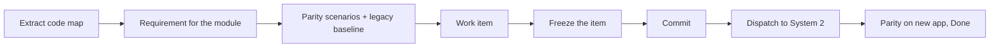

# Test drive: one module, legacy parity, one build

The shortest path from a codebase to a build by the coding pipeline (System 2). It takes one module through
the loop without first clearing the whole design. Use it for a first run, or whenever you want to try one
piece.



**The one rule to know:** the whole gate can stay red. A work item is frozen against a *scoped* gate. Only
blocking items on its own elements count, plus parse errors, files that do not parse and repeated ids. Don't
answer findings on the rest of the model to get here.

## 1. Open and map

1. `npm start -- <registry folder>`. On a new folder, Set up opens: set the model path and skip the rest.
   Set `codebase` in `designc.json` to the repository (relative to the registry).
2. **Code map**, then **Extract**. With no model yet, **Start the design from this map** turns the map
   into `model/workspace.dsl`.
3. The Design gate will show findings. Leave them. Calls between components of one container are not
   counted as hops by DC003, so a layered .NET host doesn't raise a finding on its own.

## 2. Say what the module is

1. **Design**, then **Requirements +**: one requirement for the module. Put the containers or components it
   touches in `elements` (element names from the model).
2. Optional: if `d.code` is missing, **Suggest code areas** says where a coding agent may write.

## 3. Parity scenarios and the legacy baseline

1. Draft scenarios from the legacy app's Playwright tests, or write them by hand (`docs/parity-contract.md`):

   ```
   node scripts/parity-import.js --from <legacy tests folder> --registry <registry>          # report only
   node scripts/parity-import.js --from <legacy tests folder> --registry <registry> --write  # create drafts
   ```

2. Record the legacy baseline. This is read-only by default, so committing clicks and non-GET requests are
   blocked:

   ```
   node scripts/parity-record.js --registry <registry> --scenario all --side legacy --base-url <legacy url>
   ```

3. **Parity** lists each scenario and shows whether it has a baseline.

## 4. Work item and freeze

1. **Work**, then **New item**. Use the requirement and its elements, the repo, and in `done_when` a gate
   plus parity:

   ```yaml
   done_when:
     - gate: npm test
     - parity: all
   ```

2. **Freeze item** on the card. If it is disabled, the card says why, and only items on the item's own
   elements are listed. When the whole gate is red but an item can be frozen, the Design gate says so at
   the top.
3. **Source control** opens with the commit message filled in. Review it and commit. A handover always
   names a commit.

## 5. Build and close

1. **Build it** (or **Dispatch**) on the card types the `dispatch` command from `designc.json` into the
   Terminal with the handover filled in. It doesn't press Enter: read the line, then run it.
2. When the build is merged, compare the new app and record the result at that commit:

   ```
   node scripts/parity-record.js --registry <registry> --scenario all --side next --base-url <new url> \
     --ledger --item <item id> --commit <merged sha>
   ```

3. **Run gates**, then **Done** on the card. Done needs a passing gate at a commit on main and a
   `parity_result` of `pass` for every scenario at that commit.

## When something blocks you

| You see | Do |
| --- | --- |
| Freeze item is disabled | Only the clauses it lists count. Answer those, or take the element out of the item |
| A bound decision did not clear its finding | The bind confirmation now says why: `resolves` must name the code, `binds` must use element names |
| A `.sh` check fails on Windows | Write it as `bash checks/x.sh`, with LF line endings |
| A finding is tagged "from code map" | It only says what extraction wrote. Declare what is true (`d.interaction`, `d.availability`), accept it, or leave it out of your item |
| Freeze says commit first | Commit the files it names, then freeze again |
